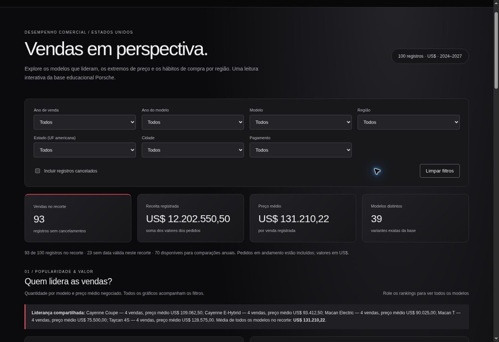
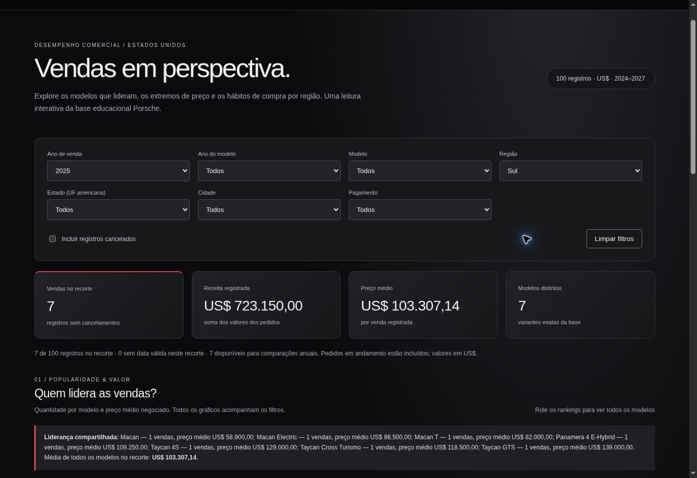

# Dashboard Porsche — análise de vendas

Dashboard interativa em um único `index.html`, com CSS, JavaScript e os dados embutidos, sem bibliotecas externas. Abra o arquivo no navegador para usar offline.

## Perguntas de negócio

1. **Qual modelo mais vendeu em cada ano de venda e como seu preço médio se compara aos demais?** Ajuda a relacionar popularidade com posicionamento de preço. O ranking considera a variante exata do modelo; a tabela anual mostra todos os líderes empatados e a média dos modelos restantes.
2. **Quais carros vendidos foram os mais caro e mais barato em cada ano?** Mostra os extremos das transações, não preços de tabela. Há cards do recorte completo e uma tabela por ano com a diferença de valor.
3. **Qual região mais compra e qual pagamento predomina por região?** Permite comparar concentração de pedidos e preferência de pagamento. Região é o agrupamento dos estados dos Estados Unidos em Nordeste, Centro-Oeste, Sul e Oeste.

## Ferramenta e decisões

Construído com assistência do ChatGPT Work, usando um fluxo de criação de site e ferramentas para ler a planilha, desenvolver HTML/CSS/JavaScript e testar no navegador. Não foi usado Canvas nem realizada uma comparação entre dois agentes. O usuário aprovou as definições antes da construção.

O projeto usa tema escuro com fundo preto, superfícies grafite, tipografia clara e detalhes em vermelho, com tipografia de sistema Arial/Helvetica. A composição, o contraste e os espaços foram inspirados no site oficial da Porsche Brasil (https://www.porsche.com/brazil/pt/), consultado em 09/11/2026. É um estudo independente, sem vínculo oficial com a Porsche, sem logos ou ativos proprietários copiados.

## Prompt inicial e refinamento

Pedido inicial do usuário:

> Faça a dashboard a partir das perguntas: qual Porsche é a mais vendida por ano e compare seus valores às demais; a mesma coisa com a mais cara e a mais barata; qual região mais realiza compras e qual método de pagamento mais utilizado por região. Se as perguntas precisarem de ajustes, envie antes para análise.

Especificação consolidada após a aprovação:

> Crie uma dashboard responsiva em um único HTML, com os dados sanitizados da planilha embutidos. Use o ano da data da venda para comparações anuais e mantenha ano do modelo como filtro separado. Mostre rankings de quantidade e preço médio por variante, todos os líderes empatados por ano, vendas individuais de maior e menor valor e comparação por região dos EUA e pagamento. Inclua filtros combináveis por ano de venda, ano do modelo, modelo, região, estado, cidade e pagamento. Mostre quantidade de vendas, receita registrada, preço médio e modelos distintos. Preserve valores em dólares. Trate datas inválidas sem inventar datas, trate conjuntos vazios, sinalize limitações . Use uma apresentação sóbria e elegante.

Refinamentos durante a execução:

- O botão e a funcionalidade de exportação CSV foram retirados a pedido do usuário.

- Atualização solicitada pelo usuário: “faça o site no modo de visualização dark seguindo o modelo do site oficial da Porsche”. O tema foi aplicado aos filtros, indicadores, tabelas, gráficos e estados de interação.

- Ao inspecionar o status dos pedidos, foram encontrados 7 cancelamentos. Excluí-los por padrão evita apresentá-los como vendas válidas; a opção para incluí-los torna a decisão auditável.
- Como existem pedidos pendentes e em trânsito, o indicador foi denominado **receita registrada**: não se trata de receita contábil realizada.
- Empates são comuns nesta amostra; os indicadores exibem todos os empatados.
- Foram adicionadas tabelas anuais, detalhamento dos registros, documentação da metodologia .

## Preparação dos dados

Fonte: [Planilha sanitizada DIO](https://hermes.dio.me/files/assets/8683bed0-cc33-4e06-bca9-04db9c31f9e2.xlsx), aba `Sanitized`, 100 linhas de dados.

Foram usadas as colunas sanitizadas de data, modelo, ano do modelo, preço, pagamento, cidade, estado e status de entrega. Os campos de nomes de clientes e vendedores, dados crus, quilometragem e identificadores desnecessários não foram publicados.

- `SalesPriceSanitized`: convertido para número, preservando centavos e USD.
- `ModelYearSanitized`: convertido para inteiro.
- `SaleDateSanitized`: datas ISO preservadas; 24 ocorrências `INVALID` viraram `null`. Não se tentou reconstruir datas ambíguas a partir do dado cru.
- Ano de venda derivado apenas das datas válidas.
- Região derivada do estado, conforme o agrupamento de estados do US Census.
- Categorias de pagamento foram mantidas separadas; Wire Transfer, Bank Transfer e ACH Payment não foram fundidos.
- Cada linha é contada uma vez. Nenhuma fórmula da planilha é necessária no HTML.
- As datas da base vão de 2024 a 2027, incluindo datas futuras no material educacional. Não são previsões produzidas pela dashboard.

Sem filtro de ano, registros sem data válida participam dos totais e dos recortes regionais. Ao selecionar ano de venda, ficam excluídos. Os quadros anuais sempre usam apenas datas válidas. As médias são ponderadas por transação (soma dos valores / quantidade de transações). Quando todos os modelos empatam, não existem "demais modelos" e essa média aparece como travessão.

## Validação

Conferência independente dos dados e teste da aplicação em navegador desktop:

| Cenário | Registros | Receita registrada |
|---|---:|---:|
| Padrão: sem cancelados | 93 | US$ 12.202.550,50 |
| Incluindo cancelados | 100 | US$ 12.827.800,50 |
| Ano 2025 + Sul, sem cancelados | 7 | US$ 723.150,00 |
| Ano 2025 + Sul + Boston | 0 | US$ 0,00 |

Foram testados filtros combinados, estado vazio, inclusão de cancelamentos e limpeza dos filtros. Os resultados anuais foram conferidos no navegador. O layout inclui regras responsivas; a inspeção visual foi feita em desktop, sem validação em dispositivo móvel real. A exportação CSV foi removida a pedido do usuário.

